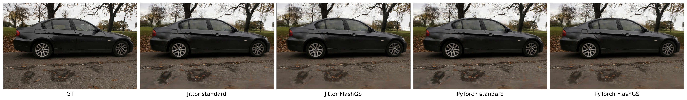

# Hybridsplat-Jittor-Render

## 项目介绍

[HybridSplat](https://github.com/Aetheryne/HybridSplat) 是面向复杂反射场景的新视角合成方法。普通 Gaussian Splatting 适合表达稳定的漫反射外观，但汽车漆面、玻璃和金属等区域的颜色会随观察方向显著变化。HybridSplat 将场景拆分为基础 Gaussian 与反射 Gaussian 两组表示，并把 Gaussian 光栅化与表面光线追踪组合在同一条推理管线中。

基础 Gaussian 保存位置、尺度、旋转、不透明度和球谐颜色等属性，负责场景的主体外观与几何信息。反射 Gaussian 额外携带反射相关属性，用于表达视角相关的高光和环境反射。渲染时，系统先光栅化基础 Gaussian，再根据反射 Gaussian 的中心、法线和观察方向生成逐 Gaussian 反射射线。OptiX 在反射 Gaussian 构建的 surfel 场景中追踪这些射线，得到间接颜色；反射光栅器随后将间接颜色投影到图像，最终与基础分支融合。

```text
                              ┌→ 基础 Gaussian 光栅化 ──────────→ diffuse 等基础结果 ┐
NPZ 权重 → 严格校验与参数激活 ┤                                                     ├→ 最终融合
                              └→ 反射射线生成 → OptiX 追踪 → 反射 Gaussian 光栅化 → reflection ┘
```

与逐像素反射追踪相比，HybridSplat 的正式路径按反射 Gaussian 生成射线，并将追踪结果作为预计算颜色交给第二次光栅化。该结构保留了 Gaussian Splatting 的图像空间合成方式，同时为镜面反射提供几何感知的间接颜色。本仓库迁移的是这条完整推理链，而非单独替换 Python 张量运算。

### Jittor 迁移范围

本仓库提供 HybridSplat 推理与渲染管线的独立 Jittor 实现，可直接读取框架中立的 NPZ 权重。迁移内容包括：

- HybridSplat checkpoint 的严格校验、参数激活和 Jittor Var 管理。
- EasyVolcap/OpenCV 相机与 FlashGS 相机的读取和矩阵计算。
- 基础与反射分支共用的五通道 Gaussian rasterizer。
- 反射方向计算、OptiX 场景构建、逐 Gaussian 追踪及间接颜色回传。
- 确定性 FlashGS 的 preprocess、CUB 排序、tile ranges 和前向光栅化。
- 双分支融合、八项 FP32 raw map、PNG、运行信息和错误报告的保存。
- 原生 context、OptiX pipeline、GAS 和 CUDA 工作区的跨视角复用。

Jittor 负责权重、相机、张量计算、执行调度和 session 生命周期；计算密集的光栅化与 OptiX 部分由 Jittor custom op 调用原生 C++/CUDA 后端。原生后端通过稳定的 C ABI 接入，不保存跨调用的 Jittor Var 指针。正式渲染进程不加载 PyTorch、ATen、c10、JTorch、CuPy 或 PyBind。

本仓库不包含训练、反向传播、优化器、致密化、剪枝或权重再训练。用户需要先在原 PyTorch 工程中取得训练完成的 checkpoint，再使用仓库提供的转换工具生成 NPZ。因此，本项目适用于已有 HybridSplat 模型的跨框架推理、渲染复现和结果验证，不构成完整训练仓库。

### 渲染后端

两个后端共用 NPZ 权重加载、OptiX 追踪、反射逻辑、结果融合、输出格式和资源生命周期。它们采用不同的光栅器；FlashGS 还使用独立的相机参数、covariance 生成和预处理流程：

- `standard`：五通道 Gaussian rasterizer 与 OptiX 反射追踪，默认后端。它保持原 PyTorch standard 管线的数值语义，适合作为迁移正确性基准。
- `flashgs`：确定性 FlashGS rasterizer 与 OptiX 反射追踪。它采用两次稳定 CUB radix sort，将等 tile-depth 键内的 Gaussian 顺序固定为 Gaussian index 升序，最终排序语义为 `(tile-depth, Gaussian index)`。该设计消除原子写入次序引起的独立进程差异，并保留 FlashGS 的 tile 化加速路径。

两个后端均返回相同的八项 raw map，调用方无需为后端差异编写两套保存与评估逻辑。`standard` 是默认选择，`flashgs` 需要显式传入 `--backend flashgs`。

## 渲染效果与迁移质量

### 视觉对比



图中依次为 GT、Jittor standard、Jittor FlashGS、PyTorch standard 和 PyTorch FlashGS。测试场景为 Ref-Real sedan，权重为 epoch 119，对比视角为 camera 0。PyTorch FlashGS 指确定性 NPZ 基准。图片用于直观观察，数值结论来自 20 个视角的 FP32 raw 输出。

### 各渲染器与 GT 的质量

| 后端 | PSNR ↑ | SSIM ↑ | LPIPS ↓ |
|---|---:|---:|---:|
| PyTorch standard | 25.525315 | 0.711357873 | 0.273558689 |
| Jittor standard | 25.525315 | 0.711357869 | 0.273558763 |
| PyTorch FlashGS | 25.573378 | 0.711074569 | 0.274994335 |
| Jittor FlashGS | 25.573378 | 0.711074569 | 0.274994310 |

standard 与 FlashGS 使用不同的光栅算法，因此二者不要求逐像素一致。迁移质量应比较 Jittor 后端与其对应的 PyTorch 后端。

### Jittor 与 PyTorch 的迁移误差

| 对比 | PSNR ↑ | SSIM ↑ | LPIPS ↓ | RGB MAE ↓ | RGB P99 ↓ |
|---|---:|---:|---:|---:|---:|
| Jittor standard / PyTorch standard | 100 dB | 0.9999999990 | 9.07×10⁻¹⁰ | 4.54×10⁻⁸ | 2.83×10⁻⁷ |
| Jittor FlashGS / PyTorch FlashGS | 100 dB | 1.0 | 3.36×10⁻¹⁶ | 0 | 0 |

指标实现将 PSNR 上限设为 100 dB。FlashGS 的 RGB raw 输出逐值一致；standard 的 RGB 平均误差和 P99 误差很小，但并非所有像素逐值一致。20 个视角的 160 个 raw 数组均为 FP32，且没有 NaN 或 Inf。

### 测试条件与性能

质量指标采用 Ref-Real sedan 的 20 个验证视角，视角编号为 0–152、步长为 8，渲染分辨率为 1292×839。性能数据在 RTX 4060 Laptop GPU、Jittor 1.3.11.0 和 CUDA 12.6 环境中取得。测试在预热后进行，并为分阶段计时插入显式同步，因此主要用于同一环境下比较两个后端，不代表所有部署方式的端到端吞吐量。

| Jittor 后端 | 平均帧时 | 平均 FPS |
|---|---:|---:|
| standard | 0.1392 s | 7.18 |
| FlashGS | 0.08474 s | 11.80 |

在该测试环境中，FlashGS 的平均速度约为 standard 的 1.64 倍。论文使用的 GPU 和计时范围不同，论文 FPS 与本表数据不能直接比较。

## 快速开始

### 环境要求

已经验证的环境如下：

- Linux 或 WSL2
- Python 3.11
- Jittor 1.3.11.0
- NumPy 1.26.4
- CUDA Toolkit 12.6
- GCC/G++ 11
- CMake 3.24 及以上、Ninja
- NVIDIA OptiX SDK 7.7 headers
- RTX 4060 Laptop GPU，`sm_89`

Jittor 1.3.11.0 是当前迁移验收版本。其他 Jittor 版本默认停止运行；完成源码与数值复核后，可以显式设置 `HYBRIDSPLAT_ALLOW_UNVERIFIED_JITTOR=1`。该设置只解除版本检查，不代表当前版本已经通过迁移验收。

### 安装项目

```bash
git clone https://github.com/Aetheryne/Hybridsplat-Jittor-Render.git
cd Hybridsplat-Jittor-Render

conda create -n hs-jt python=3.11 -y
conda activate hs-jt
pip install jittor==1.3.11.0
pip install -e .
```

### 构建原生后端

从 [NVIDIA OptiX 下载页面](https://developer.nvidia.com/designworks/optix/download) 获取 OptiX SDK，并将 `OPTIX_ROOT` 指向解压后的 SDK 根目录：

```bash
export OPTIX_ROOT=/path/to/NVIDIA-OptiX-SDK-7.7

python -m jittor_hybridsplat.ops.build \
  --optix-include "$OPTIX_ROOT/include" \
  --arch 89 \
  --build-type Release
```

构建工具依次检查命令行参数、`CUDA_HOME`、`CUDA_PATH`、`nvcc_path`、`CXX`、`cc_path`、当前 Python 环境、`PATH` 和常见安装目录，自动寻找 CUDA、C++ 编译器、CMake 与 Ninja。非标准安装可以显式传入 `--cuda-home` 和 `--cxx`。`--arch` 应与目标 GPU 的 CUDA compute capability 一致。

构建与安装目录默认位于 `~/.cache/hybridsplat_jittor_render/native/`，也可以使用 `HYBRIDSPLAT_NATIVE_BUILD_DIR` 和 `HYBRIDSPLAT_NATIVE_INSTALL_DIR` 覆盖。运行时还需要 NVIDIA 驱动提供的 `libnvoptix.so.1`；仓库不分发 OptiX SDK 或驱动二进制。

原生库从自身安装目录的 `../share/hybridsplat/forward.ptx` 加载 PTX，不保留构建机器的绝对路径。特殊部署可以设置 `HYBRIDSPLAT_OPTIX_PTX_PATH`。

### 准备数据

可从 [Ref-NeRF](https://dorverbin.github.io/refnerf/) 获取原始 Ref-Real 数据，也可以使用 [EnvGS 提供的 EasyVolcap 预处理数据](https://drive.google.com/drive/folders/1ogZF8171GatQokbECf1yCabBwm3IvDSm?usp=sharing)。本渲染器要求场景根目录至少包含相机文件：

```text
scene/
├── intri.yml
├── extri.yml
└── cameras.json   # FlashGS 必需
```

`standard` 读取 EasyVolcap/OpenCV YAML 格式的 `intri.yml` 和 `extri.yml`。`flashgs` 还需要 `cameras.json`，其相机顺序、名称和四分之一分辨率应与标准相机一致。只有执行 GT 评估时才需要参考图像目录。

### 转换 PyTorch 权重

仓库不分发模型权重。用户需要已有可信的 HybridSplat PyTorch checkpoint，并在安装了 PyTorch 的独立环境中执行：

```bash
python scripts/convert_pytorch_checkpoint.py \
  --input /path/to/latest.pt \
  --output /path/to/latest.npz \
  --report /path/to/conversion-report.json
```

转换器从 checkpoint 的 `model` state dict 中提取渲染所需的 28 个数组和 `epoch`，忽略优化器、调度器及其他训练状态。输出前会检查键集合、shape、FP32 dtype、有限值和 ZIP 结构。转换器默认使用 PyTorch 的安全 `weights_only` 模式；只有 checkpoint 来源可信且安全模式无法读取时，才可增加 `--allow-unsafe-pickle`。

PyTorch 仅用于离线权重转换。正式 Jittor 渲染进程只读取 NPZ，不需要安装 PyTorch。

### 验证安装

构建完成后检查 Jittor 版本、NPZ 权重、相机文件和原生后端：

```bash
python scripts/validate_install.py \
  --checkpoint /path/to/latest.npz \
  --dataset-root /path/to/scene \
  --native
```

报告状态必须为 `passed`。若检查失败，应先修复环境、权重或相机问题，再执行正式渲染。

### 执行渲染

standard 单视角：

```bash
python -m jittor_hybridsplat.render \
  --checkpoint /path/to/latest.npz \
  --dataset-root /path/to/scene \
  --backend standard \
  --views 0 \
  --output outputs/standard-view0 \
  --dump-raw
```

FlashGS 单视角：

```bash
python -m jittor_hybridsplat.render \
  --checkpoint /path/to/latest.npz \
  --dataset-root /path/to/scene \
  --backend flashgs \
  --views 0 \
  --output outputs/flashgs-view0 \
  --dump-raw
```

渲染 20 个验证视角：

```bash
python -m jittor_hybridsplat.render \
  --checkpoint /path/to/latest.npz \
  --dataset-root /path/to/scene \
  --backend standard \
  --views 0:160:8 \
  --output outputs/standard-20views \
  --dump-raw
```

将 `--backend standard` 改为 `--backend flashgs` 即可运行 FlashGS。`--dump-raw` 保存八项 FP32 raw map；`--stage-sync` 在各阶段插入同步，只用于诊断和分阶段计时。默认模式保持异步执行，并在每个视角末尾集中取回结果。

也可以使用随仓库提供的 [`configs/standard.json`](configs/standard.json) 和 [`configs/flashgs.json`](configs/flashgs.json)。配置文件中的相对路径以配置文件所在目录为基准。

Python 接口：

```python
from jittor_hybridsplat import HybridSplatSession

with HybridSplatSession.from_npz(
    "/path/to/latest.npz",
    "/path/to/scene",
    backend="standard",
) as session:
    raw = session.render_view(0, return_raw=True)
    rgb = raw["rgb_map"]
```

### 输出说明

输出目录包含：

- `renders/`：最终 RGB PNG。
- `raw/`：启用 `--dump-raw` 后生成的 FP32 NPZ。
- `ground_truth/`：启用评估且提供参考结果时复制的 GT。
- `metrics.json`：逐视角状态、耗时与可用的参考误差。
- `manifest.json`：后端、视角、相机和 raw 契约。
- `failed_views.json`：失败视角及错误信息；渲染器不会生成黑色占位图。
- `memory_report.json`、`environment.txt`、`render.log`：资源、环境和运行记录。

每个视角可以返回八项 HWC FP32 raw map：

1. `rgb_map`
2. `acc_map`
3. `dpt_map`
4. `norm_map`
5. `surf_norm_map`
6. `spec_map`
7. `dif_rgb_map`
8. `ref_rgb_map`

最终融合关系为：

```text
rgb_map = dif_rgb_map + 0.5 * ref_rgb_map
```

## 验证

运行仓库自带的 CPU 结构与契约测试：

```bash
python -m unittest discover -s tests -v
```

当前版本在 Linux/WSL、RTX 4060 Laptop GPU、Jittor 1.3.11.0、CUDA 12.6 和 `sm_89` 环境中完成了数值、确定性、稳定性和性能验收。其他平台、Jittor 版本、CUDA 版本或 GPU 架构需要重新构建并复核结果。

## 项目边界与许可

本仓库不包含训练代码、模型权重、数据集、编译产物、OptiX SDK 或 NVIDIA 驱动库。

仓库原创代码采用 MIT License。内置的 Gaussian rasterizer、FlashGS 和 GLM 保留各自许可证，其中 Gaussian Splatting License 对商业使用有额外限制。OptiX SDK 不在仓库内，使用者需要遵守 NVIDIA 授权条款。完整说明见 [THIRD_PARTY_NOTICES.md](THIRD_PARTY_NOTICES.md)。

## 引用

本仓库迁移自 [HybridSplat: Fast Reflection-baked Gaussian Tracing using Hybrid Splatting](https://github.com/Aetheryne/HybridSplat)。使用本项目开展研究时，请引用原论文：

```bibtex
@misc{liu2026hybridsplat,
  title={HybridSplat: Fast Reflection-baked Gaussian Tracing using Hybrid Splatting},
  author={Chang Liu and Sichao Wang and Jianwei Guo and Shi-Sheng Huang},
  note={Accepted by ACM Multimedia (ACM MM); official citation information forthcoming},
  year={2026}
}
```
